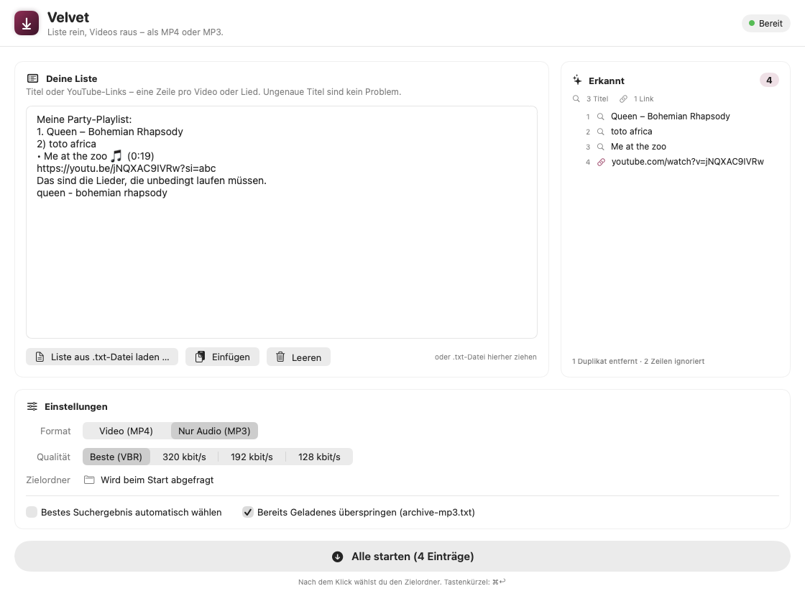
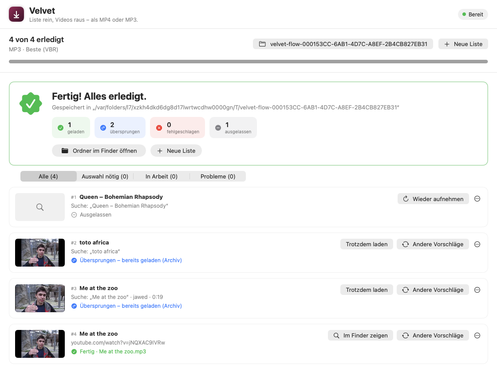

# Velvet

**Liste rein, Videos raus.** Velvet ist eine native macOS-App (SwiftUI), die aus einer beliebig formatierten Liste von YouTube-Titeln oder -Links mit wenigen Klicks MP4-Videos oder MP3-Dateien in einen Ordner deiner Wahl lädt.

- Liste einfach reinkopieren – Nummern, Spiegelstriche, Emojis, Zeitstempel, Markdown, Tabellen und Zusatztext werden automatisch herausgefiltert
- Bei Titeln zeigt Velvet **5 Vorschläge** (Vorschaubild, Titel, Kanal, Dauer, Aufrufe) – Klick = laden
- **„Andere Vorschläge“** zeigt 5 neue Treffer, **„Eigenen Link eingeben“** hilft, wenn alles falsch ist
- MP4 (Beste / 1080p / **720p** / 480p) oder MP3 (Beste VBR / 320 / 192 / 128 kbit/s, mit Cover und Tags)
- Fortschritt pro Eintrag und gesamt, mehrere Downloads gleichzeitig, Fehler stoppen den Lauf nicht
- Archiv: bereits Geladenes wird beim nächsten Mal übersprungen
- Am Ende: Zusammenfassung + „Ordner im Finder öffnen“
- Komplett auf Deutsch, Hell- und Dunkelmodus

yt-dlp, ffmpeg, ffprobe und deno sind **in der App enthalten** – nichts muss installiert werden.

| Liste einfügen | Video auswählen (Dunkelmodus) | Fertig |
|---|---|---|
|  |  |  |

---

## Installieren – Velvet als normale App

Voraussetzungen: macOS 13 oder neuer, Xcode 16 oder neuer (getestet mit Xcode 27.1 auf macOS 26, Apple Silicon).

```bash
Scripts/install.sh --open
```

Das Skript baut Velvet und legt die App nach **/Programme** (`/Applications/Velvet.app`). Danach startest du Velvet wie jede andere App – über Launchpad, Spotlight (⌘ Leertaste → „Velvet“), den Finder oder das Dock (Rechtsklick aufs Symbol → Optionen → Im Dock behalten). Ein Apple-Entwicklerkonto braucht es nicht – die App wird lokal signiert.

Nach Änderungen am Code genügt derselbe Befehl: Er baut neu und ersetzt die installierte App (läuft sie gerade, wird sie vorher beendet – bei laufenden Downloads fragt Velvet nach).

### Entwickeln mit Xcode

`Velvet.xcodeproj` öffnen und **⌘R** drücken startet die **Entwicklungsversion** („Velvet Dev“, mit orangem DEV-Abzeichen). Sie hat eine eigene Bundle-ID und eigene Einstellungen und läuft unabhängig von der installierten App – Xcode kann sie jederzeit beenden und neu starten, ohne dass Downloads in der normalen App abbrechen. Für den Alltag deshalb immer die App aus /Programme benutzen.

> Die Werkzeuge liegen im Ordner `Binaries/` und werden beim Bauen ins App-Bundle kopiert. Fehlen sie (z. B. nach einem frischen `git clone`), lädt der Build sie automatisch über `Scripts/fetch-binaries.sh` herunter. Manuell geht das so:
>
> ```bash
> Scripts/fetch-binaries.sh          # nur fehlende Werkzeuge laden
> Scripts/fetch-binaries.sh --force  # alles neu laden
> ```

Beim **allerersten Start** prüft Velvet die Werkzeuge und entpackt yt-dlp nach `~/Library/Application Support/Velvet/yt-dlp`. Das dauert einmalig etwa 10 Sekunden, weil macOS die neuen Dateien prüft. Oben rechts steht dann „Bereit“.

---

## So benutzt du Velvet

1. **Liste einfügen** – ins große Textfeld kopieren, per **„Liste aus .txt-Datei laden …“** (⌘O) öffnen oder eine `.txt`-Datei aufs Fenster ziehen. Rechts siehst du sofort, was Velvet erkannt hat.
2. **Format und Qualität wählen** – Video (MP4) oder Nur Audio (MP3).
3. **„Alle starten“** (⌘↩) – Velvet fragt nach dem Zielordner (bei jedem Lauf neu).
4. **Auswählen** – Links laden sofort. Für jeden Titel erscheinen 5 Karten; ein Klick auf die passende Karte startet den Download.
   - Falsches Video? **„Andere Vorschläge“** zeigt 5 neue Treffer. Das bereits geladene falsche Video wird nach dem neuen Download in den Papierkorb gelegt.
   - Alles falsch? **„Eigenen Link eingeben …“**
   - Suchbegriff unpassend? Oben in der Auswahl anpassen und **„Suchen“**.
   - Hover über eine Karte → ▶︎-Knopf öffnet das Video zum Prüfen im Browser.
5. **Fertig** – die Zusammenfassung zeigt Geladenes, Übersprungenes und Fehler mit Grund. **„Ordner im Finder öffnen“** bringt dich direkt zu den Dateien.

Tipp für lange Listen: **„Bestes Suchergebnis automatisch wählen“** – Velvet nimmt jeweils den ersten Treffer, du kannst danach trotzdem jeden Eintrag über „Andere Vorschläge“ korrigieren.

### Was Velvet aus einer Liste erkennt

| Eingabe | wird zu |
|---|---|
| `1. Queen – Bohemian Rhapsody`, `2)`, `(3)`, `[4]`, `#5`, `Nr. 6` | Nummer entfernt |
| `- `, `• `, `* `, `→ `, `- [ ] `, `✅ `, `🎵 ` | Aufzählungszeichen/Emoji entfernt |
| `**Queen** – *Bohemian Rhapsody*` (Markdown, z. B. aus ChatGPT) | Formatierung entfernt |
| `0:00 Intro` / `3:45 Song` (Tracklist aus einer Videobeschreibung) | Zeitstempel entfernt |
| `Toto - Africa (4:55)` | Dauer entfernt |
| `Meine Playlist:`, `## Rock`, `---`, ganze Sätze | als Zusatztext ignoriert |
| `1. 99 Luftballons`, `7 Rings`, `5:15 - The Who` | Zahlen im Titel bleiben erhalten |
| `https://youtu.be/…`, `/shorts/…`, `music.youtube.com`, `www.youtube.com/watch?v=…&t=42` | direkter Download (Link wird bereinigt) |
| `Queen – Bohemian Rhapsody: https://youtu.be/…`, `[Titel](https://…)` | Link mit Beschriftung |
| YouTube-Playlist-Link | wird in einzelne Videos aufgeteilt |
| `1. A 2. B 3. C` oder `A; B; C` in einer Zeile | mehrere Einträge |
| Tabellen: Excel/Numbers (Tabs), CSV mit `;` oder `,`, Markdown-Tabellen | „Interpret - Titel“ aus den passenden Spalten |
| Spotify-Export (Exportify-CSV), Apple-Music-Export (.txt), M3U-Playlists | Titel und Interpret |
| doppelte Einträge (`Beyoncé Halo` = `beyonce halo`) | nur einmal |

Textdateien in UTF-8, UTF-16 (Apple-Music-Export) und älteren Windows-Kodierungen werden erkannt.

### Dateien und Archiv

- Videos: `Titel.mp4` (H.264/AAC bevorzugt – läuft in QuickTime, Fotos, iPhone). Bei „Beste“ kann es VP9/AV1 sein.
- Audio: `Titel.mp3` mit Cover, Interpret und Titel als Tags (aus „Interpret - Titel“ abgeleitet).
- Zwischendateien liegen versteckt in `.velvet-temp` im Zielordner und verschwinden am Ende.
- Das Archiv liegt im Zielordner: `archive.txt` (MP4) bzw. `archive-mp3.txt` (MP3). Steht ein Video darin, wird es übersprungen. Ein Eintrag lässt sich trotzdem laden: **„Trotzdem laden“** – oder das Häkchen „Bereits Geladenes überspringen“ abschalten.

---

## Einstellungen (⌘,)

- **Gleichzeitige Downloads** (1–4, Standard 2)
- **Bestes Suchergebnis automatisch wählen**
- **Bereits Geladenes überspringen** (Archiv)
- **Cookies aus Browser** – nur nötig für altersbeschränkte Videos oder wenn YouTube eine Bot-Prüfung verlangt. Du musst im Browser bei YouTube angemeldet sein; Safari braucht dafür „Festplattenvollzugriff“ für Velvet.
- **Werkzeuge** – Versionen, „yt-dlp jetzt aktualisieren“, tägliche automatische Update-Prüfung

## Wenn etwas nicht klappt

| Problem | Lösung |
|---|---|
| Downloads scheitern plötzlich, „HTTP 403“, „Format nicht verfügbar“ | Einstellungen → Werkzeuge → **yt-dlp jetzt aktualisieren**. YouTube ändert sich oft. |
| „YouTube verlangt eine Bot-Prüfung“ / altersbeschränkt | Einstellungen → **Cookies aus Browser** wählen |
| Oben rechts „Werkzeuge fehlen“ | `Scripts/fetch-binaries.sh --force` ausführen, neu bauen (⌘R) |
| Was genau schiefging | Menü **…** am Eintrag → **Protokoll anzeigen** (kopierbar) |

---

## Technik

```
Velvet/
├─ App/            VelvetApp (Fenster, Menübefehle), AppDelegate (Beenden-Abfrage, Prozesse aufräumen)
├─ Models/         DownloadItem, ItemStatus, DownloadOptions, VideoCandidate, AppSettings, Formatters
├─ Services/       DownloadManager   – yt-dlp: Suche, Playlists, Downloads, Live-Fortschritt
│                  ProcessRunner     – startet Prozesse, liefert Ausgabe zeilenweise, Abbruch & Timeout
│                  ToolManager       – findet/prüft yt-dlp, ffmpeg, ffprobe, deno beim Start
│                  YtDlpInstaller    – entpackt & aktualisiert yt-dlp (SHA-256-geprüft)
│                  YTDLPOutput       – liest Fortschritts-/Info-Zeilen, JSON, übersetzt Fehler ins Deutsche
│                  ListParser        – macht aus beliebigem Text eine saubere Liste
│                  YouTubeLink, TextFileLoader
├─ ViewModels/     InputViewModel (Eingabe), QueueViewModel (Suche, Auswahl, Warteschlange, Zusammenfassung)
└─ Views/          InputScreen, QueueScreen, ItemRow, CandidatePicker, ManualLinkSheet, SettingsView, …
Binaries/          yt-dlp_macos.zip, ffmpeg, ffprobe, deno (per Script geladen)
Scripts/           fetch-binaries.sh
VelvetTests/       Parser-, Ausgabe-, Integrations- und UI-Ablauf-Tests
```

- **MVVM**: Views kennen nur ViewModels; die ViewModels nutzen die Services. `DownloadManager` ist ein eigener Service ohne UI-Abhängigkeit.
- **Fortschritt**: yt-dlp wird mit `--progress-template` und `--print` gestartet und liefert maschinenlesbare Zeilen (`VELVET|DL|…`). Bei getrennten Video- und Tonspuren wird der Fortschritt gewichtet zusammengerechnet; Nachbearbeitung (Zusammenführen, MP3-Umwandlung, Cover) wird mit Klartext angezeigt.
- **Suche**: `ytsearch` mit `--flat-playlist` (eine Anfrage, ca. 1 Sekunde). „Andere Vorschläge“ blendet bereits gezeigte Videos aus.
- **yt-dlp**: Velvet nutzt das offizielle `yt-dlp_macos.zip` statt der Einzeldatei `yt-dlp_macos`. Grund: Die Einzeldatei entpackt sich bei *jedem* Aufruf neu und braucht dafür ca. 7 Sekunden – bei jeder Suche und jedem Download. Die Ordner-Variante startet in 0,2 Sekunden. Weil sie sich nicht selbst aktualisieren kann, übernimmt Velvet das Update (Download von GitHub, SHA-256-Prüfung, Testlauf, dann Austausch).
- **deno** wird von yt-dlp benötigt, um YouTubes JavaScript-Prüfungen zu lösen – ohne fehlen viele Formate.
- Keine App-Sandbox (yt-dlp braucht freien Zugriff auf den gewählten Ordner und das Netzwerk). Hardened Runtime ist aktiv. Während Downloads laufen, verhindert Velvet den Ruhezustand; offene Auswahlen zeigt das Dock-Symbol als Zahl.

### Tests

```bash
# Schnelle Tests (Parser, Ausgabe-Auswertung, Formatierung)
xcodebuild test -project Velvet.xcodeproj -scheme Velvet

# Zusätzlich echte Suche, MP4-/MP3-Download, Archiv und Abbruch (Internet nötig)
TEST_RUNNER_VELVET_INTEGRATION=1 xcodebuild test -project Velvet.xcodeproj -scheme Velvet

# Kompletter Ablauf über die ViewModels inkl. Bildschirmfotos (hell/dunkel) nach /tmp/velvet-shots
TEST_RUNNER_VELVET_SNAPSHOT_DIR=/tmp/velvet-shots xcodebuild test -project Velvet.xcodeproj -scheme Velvet -only-testing:VelvetTests/UIFlowSnapshotTests
```

## Lizenzen und Hinweise

- [yt-dlp](https://github.com/yt-dlp/yt-dlp) – Unlicense
- [FFmpeg](https://ffmpeg.org) – statischer Build von [ffmpeg.martin-riedl.de](https://ffmpeg.martin-riedl.de) (GPL)
- [deno](https://deno.com) – MIT

Velvet ist für den privaten Gebrauch gedacht. Lade nur Inhalte herunter, an denen du die Rechte hast oder deren Download erlaubt ist, und beachte die Nutzungsbedingungen von YouTube.
