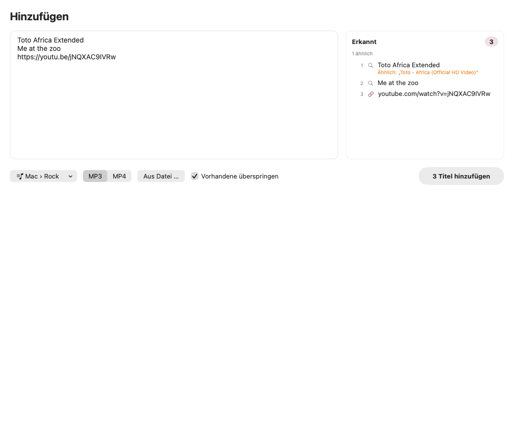
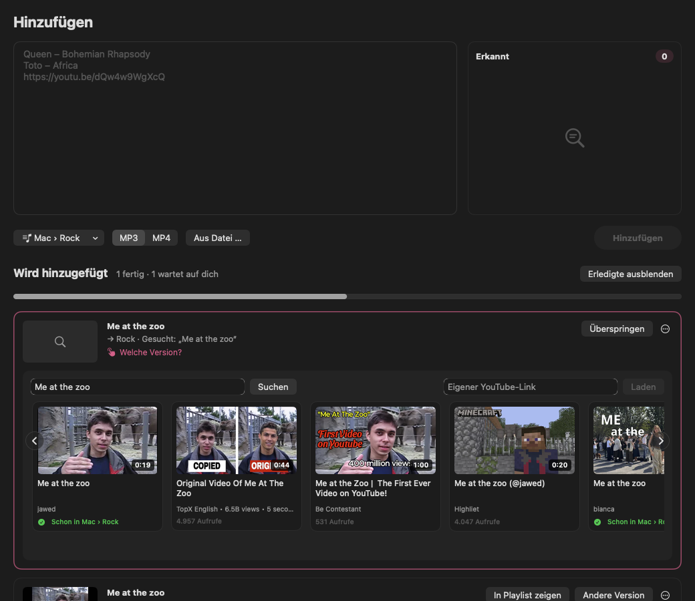
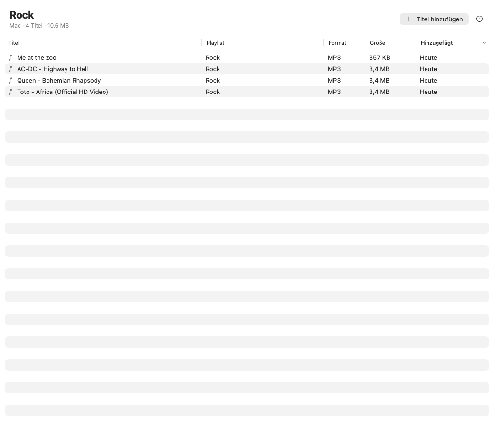
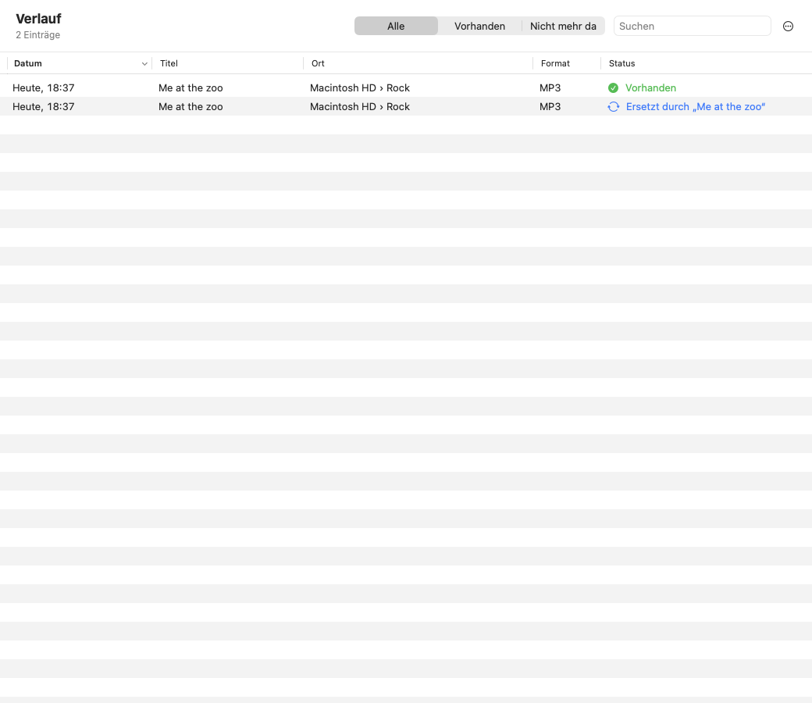

# Velvet

**Deine Musik für unterwegs.** Velvet ist eine native macOS-App (SwiftUI): einen Titel oder eine ganze Liste eingeben, die passende Version per Wischen auswählen und als MP3 (oder MP4) in eine Playlist laden – auf dem Mac oder direkt auf den USB-Stick fürs Auto. Velvet verwaltet den Stick wie eine Musik-App.

- **Hinzufügen:** ein Titel oder 50 auf einmal – rechts siehst du sofort, was erkannt wurde und was schon vorhanden ist. Nummern, Aufzählungszeichen, Tabellen, Spotify-Exporte usw. werden automatisch erkannt
- **Version auswählen per Wischen:** fünf Vorschläge mit Vorschaubild; zur Seite wischen lädt endlos weitere, zurückwischen geht jederzeit. Oder einfach einen eigenen Link einfügen
- **Bibliothek wie in einer Musik-App:** dein Musikordner auf dem Mac und jeder eingesteckte Stick in der Seitenleiste, darunter die Playlists (= Ordner)
- **Keine Doppelten:** schon vorhandene Titel sind markiert und werden übersprungen
- **Andere Version:** falschen Titel erwischt? Rechtsklick → „Andere Version …“, z. B. die Extended Version – die alte Datei wird ersetzt
- **Stick verwalten:** umbenennen, verschieben, vom Mac auf den Stick kopieren, löschen, fürs Auto aufräumen, auswerfen
- **Verlauf:** was du wann wohin geladen hast – und ob es noch da ist
- MP3 (Beste VBR / 320 / 192 / 128 kbit/s, mit Cover und Tags) oder MP4 (Beste / 1080p / 720p / 480p)

yt-dlp, ffmpeg, ffprobe und deno sind **in der App enthalten** – nichts muss installiert werden.

| Hinzufügen | Version auswählen – zur Seite wischen für mehr |
|---|---|
|  |  |

| Playlist | Verlauf |
|---|---|
|  |  |

---

## Herunterladen (ohne Xcode)

Die fertige App gibt es unter **[Releases](https://github.com/kaizerius0/Velvet/releases/latest)** als `Velvet-<Version>.dmg` – für Macs mit Apple-Chip (M1 oder neuer) ab macOS 13.

1. DMG laden, öffnen und **Velvet** auf **Programme** ziehen.
2. Velvet in Programme öffnen. macOS meldet beim ersten Mal „„Velvet“ wurde nicht geöffnet“ → **Fertig**.
3. **Systemeinstellungen → Datenschutz & Sicherheit** → ganz unten bei „„Velvet“ wurde blockiert …“ auf **Dennoch öffnen** klicken und bestätigen.

Das ist nur einmal nötig: Velvet ist nicht bei Apple notarisiert (dafür bräuchte es ein kostenpflichtiges Entwicklerkonto). Alternativ im Terminal: `xattr -dr com.apple.quarantine /Applications/Velvet.app`

Eine neue DMG baut `Scripts/make-release.sh` (Ergebnis in `dist/`).

---

## Installieren – Velvet als normale App

Voraussetzungen: macOS 13 oder neuer, Xcode 16 oder neuer (getestet mit Xcode 27.1 auf macOS 26, Apple Silicon).

```bash
Scripts/install.sh --open
```

Das Skript baut Velvet und legt die App nach **/Programme** (`/Applications/Velvet.app`). Danach startest du Velvet wie jede andere App – über Launchpad, Spotlight (⌘ Leertaste → „Velvet“), den Finder oder das Dock (Rechtsklick aufs Symbol → Optionen → Im Dock behalten). Ein Apple-Entwicklerkonto braucht es nicht – die App wird lokal signiert.

Nach Änderungen am Code genügt derselbe Befehl: Er baut neu und ersetzt die installierte App (läuft sie gerade, wird sie vorher beendet – bei laufenden Downloads fragt Velvet nach).

### Entwickeln mit Xcode

`Velvet.xcodeproj` öffnen und **⌘R** drücken startet die **Entwicklungsversion** („Velvet Dev“, mit orangem DEV-Abzeichen). Sie hat eine eigene Bundle-ID und eigene Einstellungen und läuft unabhängig von der installierten App – Xcode kann sie jederzeit beenden und neu starten, ohne dass Downloads in der normalen App abbrechen. Für den Alltag deshalb immer die App aus /Programme benutzen.

> Die Werkzeuge liegen im Ordner `Binaries/` und werden beim Bauen ins App-Bundle kopiert. Fehlen sie (z. B. nach einem frischen `git clone`), lädt der Build sie automatisch über `Scripts/fetch-binaries.sh` herunter. Manuell geht das so:
>
> ```bash
> Scripts/fetch-binaries.sh          # nur fehlende Werkzeuge laden
> Scripts/fetch-binaries.sh --force  # alles neu laden
> ```

Beim **allerersten Start** prüft Velvet die Werkzeuge und entpackt yt-dlp nach `~/Library/Application Support/Velvet/yt-dlp`. Das dauert einmalig etwa 10 Sekunden, weil macOS die neuen Dateien prüft. Oben rechts steht dann „Bereit“.

---

## So benutzt du Velvet

**Links** in der Seitenleiste: ganz oben **Hinzufügen**, darunter dein Musikordner auf dem Mac (Standard: `~/Musik/Velvet`) und jeder eingesteckte Stick – mit seinen Playlists. Ein Stick erscheint automatisch, sobald er eingesteckt ist; **+** neben dem Namen legt eine Playlist an, ⏏︎ wirft ihn aus.

**Hinzufügen** (⌘L):
1. Einen Titel oder eine ganze Liste ins große Feld schreiben oder einfügen – oder eine Textdatei aufs Fenster ziehen. Rechts steht, was erkannt wurde und was es schon gibt („Schon in AUTO-STICK › Rock“).
2. Unten das **Ziel** wählen (z. B. „AUTO-STICK › Rock“ oder „Neue Playlist …“) und MP3 oder MP4.
3. **„3 Titel hinzufügen“** (⌘↩). Links laden sofort, bei Titeln wählst du die passende Version: fünf Vorschläge mit Vorschaubild – **zur Seite wischen** (Trackpad) oder die Pfeile nutzen, dann kommen automatisch weitere, zurück geht auch. Passt nichts: Suchbegriff anpassen oder eigenen YouTube-Link einfügen.
4. Während Titel laden, kannst du schon die nächsten eingeben. Fertige Titel zeigen **„In Playlist zeigen“** und **„Andere Version“**; **„Erledigte ausblenden“** räumt die Liste auf.

In jeder Playlist führt **„Titel hinzufügen“** direkt dorthin – mit dieser Playlist als Ziel.

**Rechtsklick auf einen Titel in einer Playlist:** Abspielen, **Andere Version …** (z. B. Extended – die alte Datei wird ersetzt), Umbenennen, **Verschieben nach** (andere Playlist), **Kopieren nach** (z. B. vom Mac auf den Stick), Im Finder zeigen, Löschen.

**Für das Auto:** Menü **…** oben rechts → **Für das Auto aufräumen** entfernt die unsichtbaren Mac-Begleitdateien (`._Titel.mp3`, `.DS_Store`), die viele Autoradios als kaputte Titel anzeigen. Danach **Auswerfen**.

Auf dem Stick löscht Velvet **endgültig** (ein Papierkorb auf dem Stick würde im Auto nur stören) und fragt vorher nach. Auf dem Mac landet Gelöschtes im Papierkorb.

**Verlauf** (⌘Y): jeder Download mit Datum, Titel, Ort und Status – *Vorhanden*, *Stick nicht verbunden*, *Nicht mehr da*, *Ersetzt durch …* oder *Gelöscht*. Per Rechtsklick abspielen, im Finder zeigen, auf YouTube öffnen oder erneut hinzufügen. Gespeichert in `~/Library/Application Support/Velvet/history.json`.

| Tastenkürzel | |
|---|---|
| ⌘L | Hinzufügen |
| ⌘↩ | Titel hinzufügen (im Bereich Hinzufügen) |
| ⌘O | Titel aus Datei hinzufügen |
| ⌘N | Neue Playlist |
| ⌘Y | Verlauf |
| ⌘, | Einstellungen |

### Was Velvet beim Einfügen mehrerer Titel erkennt

| Eingabe | wird zu |
|---|---|
| `1. Queen – Bohemian Rhapsody`, `2)`, `(3)`, `[4]`, `#5`, `Nr. 6` | Nummer entfernt |
| `- `, `• `, `* `, `→ `, `- [ ] `, `✅ `, `🎵 ` | Aufzählungszeichen/Emoji entfernt |
| `**Queen** – *Bohemian Rhapsody*` (Markdown, z. B. aus ChatGPT) | Formatierung entfernt |
| `0:00 Intro` / `3:45 Song` (Tracklist aus einer Videobeschreibung) | Zeitstempel entfernt |
| `Toto - Africa (4:55)` | Dauer entfernt |
| `Meine Playlist:`, `## Rock`, `---`, ganze Sätze | als Zusatztext ignoriert |
| `1. 99 Luftballons`, `7 Rings`, `5:15 - The Who` | Zahlen im Titel bleiben erhalten |
| `https://youtu.be/…`, `/shorts/…`, `music.youtube.com`, `www.youtube.com/watch?v=…&t=42` | direkter Download (Link wird bereinigt) |
| `Queen – Bohemian Rhapsody: https://youtu.be/…`, `[Titel](https://…)` | Link mit Beschriftung |
| YouTube-Playlist-Link | wird in einzelne Videos aufgeteilt |
| `1. A 2. B 3. C` oder `A; B; C` in einer Zeile | mehrere Einträge |
| Tabellen: Excel/Numbers (Tabs), CSV mit `;` oder `,`, Markdown-Tabellen | „Interpret - Titel“ aus den passenden Spalten |
| Spotify-Export (Exportify-CSV), Apple-Music-Export (.txt), M3U-Playlists | Titel und Interpret |
| doppelte Einträge (`Beyoncé Halo` = `beyonce halo`) | nur einmal |

Textdateien in UTF-8, UTF-16 (Apple-Music-Export) und älteren Windows-Kodierungen werden erkannt.

### Dateien und Archiv

- Videos: `Titel.mp4` (H.264/AAC bevorzugt – läuft in QuickTime, Fotos, iPhone). Bei „Beste“ kann es VP9/AV1 sein.
- Audio: `Titel.mp3` mit Cover, Interpret und Titel als Tags (aus „Interpret - Titel“ abgeleitet).
- Zwischendateien liegen versteckt in `.velvet-temp` im Ordner der Playlist und verschwinden, sobald der Titel fertig ist.
- Optional (Einstellungen): eine Archivdatei pro Ordner (`archive.txt` / `archive-mp3.txt`), damit yt-dlp schon geladene Videos überspringt. Standardmäßig aus – die Duplikat-Erkennung übernimmt das.

---

## Einstellungen (⌘,)

- **Qualität** für MP3 und MP4 (das Format selbst wählst du unter „Hinzufügen“)
- **Gleichzeitige Downloads** (1–4, Standard 2)
- **Bei mehreren Titeln den ersten Treffer nehmen** – spart Klicks bei langen Listen
- **Archivdatei im Ordner führen**
- **Cookies aus Browser** – nur nötig für altersbeschränkte Videos oder wenn YouTube eine Bot-Prüfung verlangt. Du musst im Browser bei YouTube angemeldet sein; Safari braucht dafür „Festplattenvollzugriff“ für Velvet.
- **Werkzeuge** – Versionen, „yt-dlp jetzt aktualisieren“, tägliche automatische Update-Prüfung

Den Musikordner auf dem Mac änderst du über **…** → **Musikordner wählen …** (in einer Playlist auf dem Mac).

## Wenn etwas nicht klappt

| Problem | Lösung |
|---|---|
| Downloads scheitern plötzlich, „HTTP 403“, „Format nicht verfügbar“ | Einstellungen → Werkzeuge → **yt-dlp jetzt aktualisieren**. YouTube ändert sich oft. |
| „YouTube verlangt eine Bot-Prüfung“ / altersbeschränkt | Einstellungen → **Cookies aus Browser** wählen |
| Unten links „Werkzeuge fehlen“ | `Scripts/fetch-binaries.sh --force` ausführen, neu bauen (⌘R) |
| Ein Titel lädt nicht | Unter „Hinzufügen“ am Titel „Erneut versuchen“ oder „Andere Version“ |

---

## Technik

```
Velvet/
├─ App/            VelvetApp (Fenster, Menübefehle), AppDelegate (Beenden-Abfrage, Prozesse aufräumen), AppNavigation
├─ Models/         DownloadItem, ItemStatus, DownloadOptions, VideoCandidate, AppSettings, Formatters,
│                  Library (VolumeInfo, LibrarySource, Playlist, Track, HistoryEntry, DuplicateHit)
├─ Services/       DownloadManager   – yt-dlp: Suche, Playlists, Downloads, Live-Fortschritt
│                  ProcessRunner     – startet Prozesse, liefert Ausgabe zeilenweise, Abbruch & Timeout
│                  ToolManager       – findet/prüft yt-dlp, ffmpeg, ffprobe, deno beim Start
│                  YtDlpInstaller    – entpackt & aktualisiert yt-dlp (SHA-256-geprüft)
│                  YTDLPOutput       – liest Fortschritts-/Info-Zeilen, JSON, übersetzt Fehler ins Deutsche
│                  ListParser        – erkennt Titel und Links in beliebig formatiertem Text
│                  HistoryStore      – Verlauf (JSON), findet Dateien auch auf umbenannten Sticks
│                  LibraryFiles      – Playlists einlesen, umbenennen, verschieben, löschen, fürs Auto aufräumen
│                  VolumeService     – Sticks erkennen und auswerfen
│                  TitleMatcher, DuplicateChecker – „schon vorhanden?“ (gleich / ähnlich)
│                  YouTubeLink, TextFileLoader
├─ ViewModels/     LibraryViewModel (Mac-Ordner & Sticks, Playlists), QueueViewModel (Warteschlange je Playlist),
│                  InputViewModel (Eingabe), ReplaceViewModel (andere Version)
└─ Views/          ContentView (Seitenleiste), AddScreen, CandidateViews (Wisch-Auswahl), PlaylistScreen, HistoryScreen, …
Binaries/          yt-dlp_macos.zip, ffmpeg, ffprobe, deno (per Script geladen)
Scripts/           fetch-binaries.sh, install.sh, make-release.sh
VelvetTests/       Parser-, Ausgabe-, Integrations- und UI-Ablauf-Tests
```

- **MVVM**: Views kennen nur ViewModels; die ViewModels nutzen die Services. `DownloadManager` ist ein eigener Service ohne UI-Abhängigkeit.
- **Fortschritt**: yt-dlp wird mit `--progress-template` und `--print` gestartet und liefert maschinenlesbare Zeilen (`VELVET|DL|…`). Bei getrennten Video- und Tonspuren wird der Fortschritt gewichtet zusammengerechnet; Nachbearbeitung (Zusammenführen, MP3-Umwandlung, Cover) wird mit Klartext angezeigt.
- **Suche**: `ytsearch` mit `--flat-playlist` (eine Anfrage, ca. 1 Sekunde). Beim Wischen werden jeweils fünf weitere, noch nicht gezeigte Videos angehängt.
- **Warteschlange**: Jeder Titel kennt seine Ziel-Playlist; mehrere laden parallel. Fertige Titel verschwinden aus der Warteschlange und stehen dann in der Playlist.
- **yt-dlp**: Velvet nutzt das offizielle `yt-dlp_macos.zip` statt der Einzeldatei `yt-dlp_macos`. Grund: Die Einzeldatei entpackt sich bei *jedem* Aufruf neu und braucht dafür ca. 7 Sekunden – bei jeder Suche und jedem Download. Die Ordner-Variante startet in 0,2 Sekunden. Weil sie sich nicht selbst aktualisieren kann, übernimmt Velvet das Update (Download von GitHub, SHA-256-Prüfung, Testlauf, dann Austausch).
- **deno** wird von yt-dlp benötigt, um YouTubes JavaScript-Prüfungen zu lösen – ohne fehlen viele Formate.
- Keine App-Sandbox (yt-dlp braucht freien Zugriff auf den gewählten Ordner und das Netzwerk). Hardened Runtime ist aktiv. Während Downloads laufen, verhindert Velvet den Ruhezustand; offene Auswahlen zeigt das Dock-Symbol als Zahl.

### Tests

```bash
# Schnelle Tests (Parser, Ausgabe-Auswertung, Formatierung)
xcodebuild test -project Velvet.xcodeproj -scheme Velvet

# Zusätzlich echte Suche, MP4-/MP3-Download, Archiv und Abbruch (Internet nötig)
TEST_RUNNER_VELVET_INTEGRATION=1 xcodebuild test -project Velvet.xcodeproj -scheme Velvet

# Kompletter Ablauf über die ViewModels inkl. Bildschirmfotos (hell/dunkel) nach /tmp/velvet-shots
TEST_RUNNER_VELVET_SNAPSHOT_DIR=/tmp/velvet-shots xcodebuild test -project Velvet.xcodeproj -scheme Velvet -only-testing:VelvetTests/UIFlowSnapshotTests
```

## Lizenzen und Hinweise

- [yt-dlp](https://github.com/yt-dlp/yt-dlp) – Unlicense
- [FFmpeg](https://ffmpeg.org) – statischer Build von [ffmpeg.martin-riedl.de](https://ffmpeg.martin-riedl.de) (GPL)
- [deno](https://deno.com) – MIT

Velvet ist für den privaten Gebrauch gedacht. Lade nur Inhalte herunter, an denen du die Rechte hast oder deren Download erlaubt ist, und beachte die Nutzungsbedingungen von YouTube.
